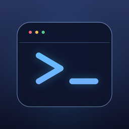

# Mac Terminal

[](https://github.com/Davin-X/mac-terminal/actions/workflows/macos.yml)

A fast, local-first terminal emulator for macOS. Mac Terminal combines a native
Rust pseudoterminal with a responsive terminal interface and a focused,
customizable workspace.



## Features

### Terminal
- **Real PTY** — each tab is a native macOS pseudoterminal running your login shell (`zsh` by default), so `.zprofile` / `.zshrc`, colors, vim, htop and ssh work as expected
- **Clickable links** — URLs in output open in your browser
- **Exit aware** — when a shell exits you get a hint; ⌘R restarts the pane
- **Perf tuned** — GPU (WebGL) rendering with a canvas fallback, rAF-coalesced writes capped at ~60 fps, 32 KB PTY reads batched into single events, debounced resize

### Tabs
- ⌘T new, ⌘W close pane/tab, ⇧⌘W close tab, ⌘1–⌘9 jump, ⌃Tab / ⌃⇧Tab cycle
- **Closing the last tab quits the app** (toggleable in Settings) instead of leaving an empty window behind
- **＋ button sits right after the last tab**, browser-style (as well as ⌘T)
- **Live titles** from the shell (OSC 0/2), falling back to `Terminal N`
- **Double-click a tab to rename** it
- **Right-click a tab** for the tab menu: close tab / other tabs / tabs to the left / tabs to the right / all tabs, split, rename
- **Drag to reorder** tabs; ⌘1–⌘9 follows the visual order
- Activity dot pulses while a tab is producing output

### Panes
- ⌘D split side-by-side, ⇧⌘D split stacked, up to 4 panes per tab
- ⇧⌘B **broadcast input** — type once, send to every pane in the tab
- ⌘R restart the active pane in place (keeps its position)

### Search
- ⌘F to open; Enter = next, ⇧Enter = previous, Esc = close (the bar stays open while you click in the terminal)
- Toggles for **match case**, **whole word** and **regular expression**
- Live **match counter** (`3/17` / `no results`) with highlighted matches

### Right-click menus

The embedded web view would otherwise show its own browser menu ("Reload Page", "Back", …), so every right-click is claimed by the app:

- **On a terminal pane** — copy / paste / select all, find (pre-filled when you right-clicked a selection), clear, restart pane, split, broadcast, new tab, rename, close pane / tab, close others / all
- **On a tab** — split, rename, close this / other / left / right / all tabs
- **Empty tab-strip space** — new tab, close all tabs
- **Anywhere else in the chrome** — new tab, splits, find, palette, settings, shortcuts, full screen
- **Text fields** keep the native editing menu, so cut/copy/paste still works

### Command palette
- ⇧⌘P — fuzzy search across all commands, grouped by category, recently used first

### Appearance & settings
- **8 themes** — Tokyo Night, Dracula, Catppuccin, Nord, Gruvbox, One Dark, Matrix, Light
- Font family, font size (⌘+ / ⌘− / ⌘0), line height, pane padding, scrollback size, cursor style, blinking cursor
- **Single-width Nerd Font, bundled with the app** — no font install needed. The terminal always gets real prompt/folder/branch glyphs at exactly one cell wide, with a **live preview** in Settings. (External Nerd Fonts in `~/Library/Fonts` are deliberately not used: the embedded web view cannot resolve them, so the terminal silently fell back to Menlo — see `src/fonts/README.md`.)
- **Glass intensity** slider, toggleable backdrop blur
- Copy-on-select, confirm-before-close, quit-when-last-tab-closes
- Every setting is persisted to `localStorage`

### Floating panels

Every panel has a **× close button** and closes on **Esc**; focus returns to the terminal so you can keep typing. Beyond that, dismissal follows what the panel is for:

- **Command palette** and the **shortcuts sheet** are transient — they also close when you click anywhere outside them
- **Search** and the **settings drawer** stay open until you close them, so clicking in the terminal never makes the find bar vanish. Only one panel is open at a time

### macOS polish
- Overlay titlebar with traffic lights, transparent window, bundled JetBrainsMono NL Nerd Font Mono at 13 pt
- Drag anywhere on the titlebar; **double-click the titlebar for native full screen** (or ⌃⌘F)
- **Global hotkey** (Alt+Space) summons/hides the terminal from anywhere
- Status bar: shell, focused pane title, working directory (via OSC 7), broadcast badge, zoom level and live terminal size
- ⌘/ opens an in-app keyboard shortcut cheat sheet

## Icon

The app icon is generated from source by `assets/make-icon.py`: a high-contrast
terminal window and prompt designed to remain recognizable at Dock icon sizes.
Pillow renders the 1024×1024 source, then the Tauri CLI expands it into platform
icon sizes.

```bash
python3 assets/make-icon.py          # -> assets/icon-source.png
npx tauri icon assets/icon-source.png # -> src-tauri/icons/*
```

Requires `pillow` (`pip install pillow`).

## Privacy and safety

Terminal sessions run locally through native PTYs. The app does not require an
account or send terminal output, settings, or command history to a service.
Commands you run in the shell can of course access the network. Clicking a
terminal link opens only an HTTP or HTTPS URL in the system browser. Settings
are stored locally in WebKit's app data; they are not credentials storage.
The app does not include analytics or automatic update checks.

The bundled WebView uses a Content Security Policy that restricts scripts,
frames, and network connections to the app and Tauri IPC. The app bundle is
currently ad-hoc signed and not notarized; review the Gatekeeper notes above
before distributing a downloaded build.

See [SECURITY.md](./SECURITY.md) for vulnerability reporting and
[THIRD_PARTY_NOTICES.md](./THIRD_PARTY_NOTICES.md) for bundled component
attributions and licenses.

## Support and contributing

Bug reports and feature requests are welcome through
[GitHub Issues](https://github.com/Davin-X/mac-terminal/issues). Please do not
include secrets, private keys, access tokens, or sensitive terminal output in an
issue. See [CONTRIBUTING.md](./CONTRIBUTING.md) before opening a pull request.

This project is licensed under the MIT License. See [LICENSE](./LICENSE).

## Project layout

```
mac-terminal/
├── src/                     # frontend (Vite + xterm.js)
│   ├── index.html           # chrome, inline SVG icons, overlays
│   ├── main.js              # tabs, panes, search, palette, settings, IPC
│   └── styles.css           # theming via CSS custom properties
├── assets/
│   ├── make-icon.py         # icon generator
│   └── icon-source.png      # 1024×1024 source icon
├── src-tauri/               # backend (Rust)
│   ├── src/main.rs          # PTY sessions via portable-pty
│   ├── tauri.conf.json
│   └── capabilities/default.json
└── dist/                    # built frontend (generated)
```

## Run it

Prerequisites: Node.js 20+, Rust stable, Xcode Command Line Tools.

```bash
npm ci

# Dev mode (hot reload):
npx tauri dev

# Production .app:
npx tauri build
# → src-tauri/target/release/bundle/

# Frontend production build and Rust backend tests:
npm run check

# Remove generated frontend and Rust build outputs:
npm run clean

# Both architectures in one .app + .dmg, for handing to someone else:
rustup target add x86_64-apple-darwin
npm run bundle:universal
# → src-tauri/target/universal-apple-darwin/release/bundle/dmg/
```

`npm run clean` removes `dist/` and `src-tauri/target/`, including generated app
bundles and DMGs. It leaves source files, icons, and installed npm dependencies
untouched.

### Sharing it

The app is self-contained: its frontend and terminal font are bundled, and it
uses macOS system frameworks. Open the `.dmg` and drag the app to
`/Applications`. Two caveats:

- **Architecture.** A plain `npx tauri build` produces an `arm64`-only binary,
  which will not launch on an Intel Mac. Use `npm run bundle:universal` to ship
  `x86_64 + arm64` in one bundle.
- **Gatekeeper.** Development builds are ad-hoc signed and not notarized; macOS
  may warn or block them when downloaded. Do not bypass Gatekeeper for an
  untrusted build. A public release should be signed with a *Developer ID
  Application* certificate and hardened runtime, then notarized with
  `xcrun notarytool submit --wait` and stapled with `xcrun stapler staple`.

  Recipients never need to install a font, and each user gets their own settings
  under `~/Library/WebKit/io.github.davinx.macterminal`.

The app bundle includes the project license and third-party notices in
`Contents/Resources`.

## How it works

1. The frontend creates an xterm.js instance per pane, sized with the fit addon.
2. `create_terminal` opens a native PTY pair, spawns your login shell, and returns a session id.
3. A Rust thread pumps PTY bytes to the frontend via `pty-output-{id}` events; keystrokes go back through `write_terminal`. Resize propagates via `resize_terminal`.
4. Settings live in `localStorage`; the theme accent is exposed as a CSS variable so all chrome
   (tabs, badges, glow, toggles) recolors with the terminal.
